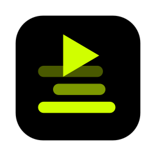
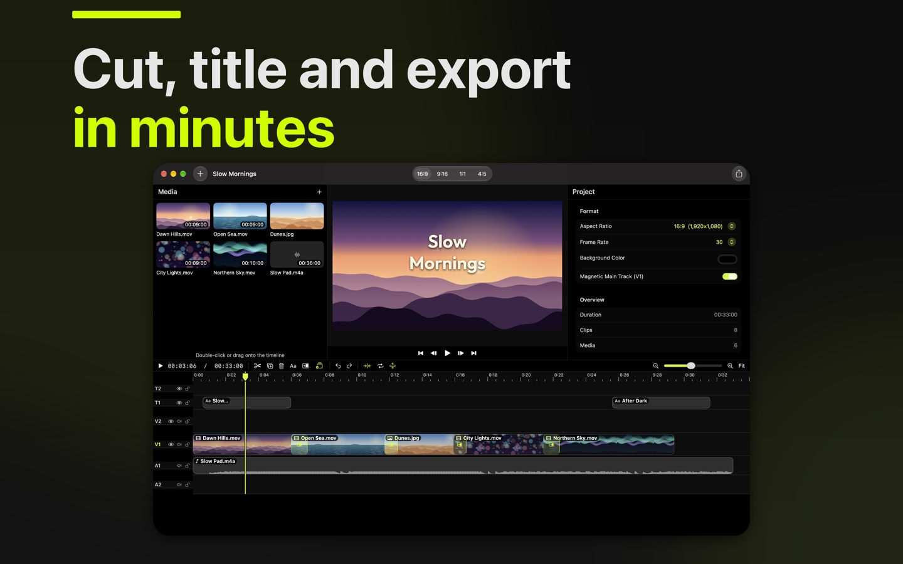

# Edwell

Cut, title and export in minutes.

<!-- Written by hand until Edwell is in iamjarl-design's apps.json (JarlLyng/iamjarl-design#114). Then replace this block with dist/store/edwell.en.readme.md. -->
<p>
  <a href="https://apps.apple.com/app/id6825963733?pt=128512007&amp;ct=github&amp;mt=12"><picture>
    <source media="(prefers-color-scheme: dark)" srcset="https://raw.githubusercontent.com/JarlLyng/iamjarl-design/v1.35.0/badges/mac-app-store-white-en-us.svg">
    
  </picture></a>
  <br>
  Free to try for 14 days, then $9.99 once · macOS 14 or later · <a href="https://edwell.iamjarl.com">edwell.iamjarl.com</a>
</p>

<p>
  
</p>

Edwell is a simple video editor for your Mac. Put your clips on a timeline, cut them with a key or two, drop a title on the picture and export an MP4 that's widescreen, vertical, square or portrait. It's made for people who edit a video now and then and want it done in minutes, without learning a pro editor or paying for one every month. Everything happens on your Mac: your videos are never uploaded, and there's no account and no tracking.

## For developers

<p>
  <a href="https://madebyhuman.iamjarl.com"><picture>
    <source media="(prefers-color-scheme: dark)" srcset="https://madebyhuman.iamjarl.com/badges/co-created-white.svg">
    </picture></a>
  <a href="LICENSE"></a>
  <a href="https://github.com/JarlLyng/Eddie-tor/actions/workflows/ci.yml"></a>
</p>

The developer half: what's in the app, how to build and test it, and how it's put together. Edwell was made to replace Adobe Premiere Rush, which Adobe has retired, and it keeps the parts of Rush that actually get used. Eddie is its working name, kept for this repo and the code (`EddieKit`). The interface is in English and Danish, and it runs on macOS 14 Sonoma and later.

### What's in it

- **First run** is an empty timeline that says where the first files go, with an Import button. Once there are clips, one tip above the timeline: split with S, add a title with G, export with ⌘E. Close the tip and it stays closed; it also goes after the first export
- **Import** video, audio and images (the **+** button, ⌘I, a drop on Media, or files opened from Finder): they go onto the end of the timeline one after another, video and photos on the Video track and music on the Audio track, and an empty timeline zooms to show them. Or drag files straight onto a track to place them
- **A quiet window**: above the timeline only Split, Title, Transition and Delete, and zoom. The media bin is hidden at first (the sidebar button or Y shows it, and it stays as you left it). With nothing selected, the inspector shows the format, the background and the length, with frame rate and gap closing under More Settings. The shortcuts are in Help › Keyboard Shortcuts (⌘/)
- **The format follows the first clip**: the first video or photo in a new project sets 16:9, 9:16, 1:1 or 4:5 to its own shape, until you pick a format yourself
- **Magnetic main track**: clips on the first video track always follow each other, so deleting and trimming close the gap. Drag a clip to move it to a new place
- **More tracks**, named for what they hold (Title, Video, Video 2, Audio …). The timeline shows the first of each and any track with a clip on it; drag a clip up or down to use another, and past the last one to make a new one (up to 8 video, 6 title and 8 audio tracks). Each track can be hidden, muted and locked, with switches that show when the pointer is on the track's name
- **Clips**: move (also between tracks), trim at the edges, split (S), ripple trim to the playhead (Q/W), duplicate (D), copy/cut/paste and detach the audio from the video (E)
- **Transitions**: cross dissolve, dip to black or white, and push in four directions, at the start and end of a clip. Between two clips on the main track they overlap, and the sound cross-fades too
- **Speed**: 10–1000 % per clip, with or without preserved pitch
- **Size and position**: fill the frame or show the whole picture, size, position, rotation, opacity, flipping, and crop with a soft edge
- **Titles**: four styles to start from (Big Center, Big Left, Lower Third, Caption), nine places in the frame one click each, a short font list with every other font under All Fonts, size and color; weight (100–900), alignment, line spacing, shadow, background box, exact position and fade under More Settings. A new title (G) has its text selected, so you just type; Escape or a click elsewhere ends the typing. It goes where no other title shows at that moment. Drag the text directly in the preview. Outfit ships with the app (OFL, from the design system), so projects look the same on every Mac
- **Audio**: volume per clip (0–200 %), mute, fade in and out
- **Format**: 16:9, 9:16, 1:1 and 4:5
- **Export** to MP4 (H.264 or HEVC) in 1080p: ⌘E opens the save panel straight away, with the file type and the in/out range below the name, and the finished video has Show in Finder and Share…. The whole project or only between the in and out points. The bitrate is the app's own, set from the frame size, the frame rate and how much the picture moves, with AAC sound at 48 kHz. Cancel stops an export halfway and leaves no file
- **New Ambient Session**, the maker's own template, kept out of sight: hold ⌥ in the File menu and New Project turns into it (⌥⌘N). Choose the recording, and the app sets it up as it was done in Rush: the whole recording on V1 with a 0.5 s dip to black and a sound fade at both ends, and the title "Ambient / Session NNN" from 11.2 to 50.8 s, left-aligned in Outfit ExtraBold 177 px, in the session's own color. Then put the playhead where the session starts and press **Q**, and where it ends and press **W**. The title stays at 11.2 s
- Undo/redo, autosave, and projects saved as `.edwell` files (old `.eddie` files still open)
- **Trial and purchase**: everything works for 14 days, then export needs one purchase ($9.99 once, no subscription). Projects always open and edit. Restore Purchases is in the Edwell menu. A build you make yourself with `./build.sh` is unlocked
- **Send Feedback…** in the Help menu opens a draft to support@iamjarl.com in your mail app, with the app's and macOS's versions filled in. You see all of it and send it or not. About Edwell shows the version and the same address
- **Media that moves**: the app remembers each file it's given, follows it when it's renamed or moved, and asks with **Find…** when it can't be read

### Shortcuts

| Key | Action |
|---|---|
| Space | Play / pause |
| J K L | Rewind / stop / forward (press again to go faster) |
| ← → | One frame back / forward (with ⇧: one second) |
| ↑ ↓ | Previous / next clip edge |
| S | Split the clip at the playhead |
| Q W | Trim the start / end to the playhead |
| D | Duplicate |
| G | New title |
| E | Detach audio |
| ⌫ | Delete |
| ⌘D | Add the default transition (cross dissolve) |
| ⌘C ⌘X ⌘V | Copy / cut / paste at the playhead |
| I O | Set the in / out point (⇧ goes there, ⌥ clears it, ⌥X clears both) |
| = − \ | Zoom in / out / the whole timeline |
| ⌘Y | Snap on/off |
| ⌘L | Loop playback |
| ⌘1 ⌘2 ⌘4 ⌘5 ⌘6 | Text, transitions, speed, audio, position |
| \` | Large preview |
| Y | Show/hide media |
| esc | Stop typing in a text field |
| ⌘/ | Keyboard Shortcuts |
| ⌘Z / ⇧⌘Z | Undo / redo |
| ⌘S, ⌘O, ⌘E | Save, open, export |

### Not there yet

See also [docs/rush-reference.md](docs/rush-reference.md): everything Rush could do, how it was used for the Ambient Sessions, and what is still missing.

Color filters, speed for only part of a clip (ramps), animated title templates, pan and zoom, auto reframe, auto ducking, noise reduction and voice-over recording.

### Design

The app uses the [IAMJARL design system](https://github.com/JarlLyng/iamjarl-design) (the Swift package `IAMJARLDesignTokens`): every color, spacing, radius and type size in the interface comes from there, and the app follows the system's light or dark mode. `Sources/EddieKit/Theme.swift` holds what the app derives from the tokens (the clips' neutral fill and the button styles). The colors in the video itself, such as title colors and the background, are the user's content and not part of the design system.

### Build and test

The app is built with Xcode from `App/Edwell.xcodeproj` (generated from `App/project.yml` with [XcodeGen](https://github.com/yonaskolb/XcodeGen)) and runs in the App Sandbox like the App Store version. The self test and `swift build` need only the Xcode Command Line Tools (`xcode-select --install`).

```bash
./build.sh            # builds build/Edwell.app
./build.sh --open     # builds and opens it
./build.sh --install  # builds and copies it to /Applications
```

The App Store version is built by Xcode Cloud from the `release` branch; see [XCODE_CLOUD.md](XCODE_CLOUD.md).

English is the development language and Danish a localization, both in `App/Edwell/Localizable.xcstrings`. After adding or changing text in the interface, update the catalog from the code, then add the Danish translation the script lists:

```bash
scripts/sync-strings.sh
```

Test with a real session (builds the template, trims as Rush did for session 011, exports and compares with Rush's video; `--full` exports the whole hour):

```bash
.build/debug/Eddie --session-test "<recording>.mov" /tmp/eddie-session "<Rush's finished video>.mp4"
```

The trial and the purchase are tested against Xcode's local StoreKit (`App/Edwell.storekit`), with no App Store account involved:

```bash
xcodebuild test -project App/Edwell.xcodeproj -scheme Edwell -destination 'platform=macOS' CODE_SIGN_IDENTITY=- CODE_SIGN_STYLE=Manual DEVELOPMENT_TEAM=
```

Self test (makes test videos, exports a project with every kind of clip, and tests the editing, media access, the store build and the translations):

```bash
swift build && .build/debug/Eddie --selftest /tmp/eddie-test
```

### Layout

| File | Contents |
|---|---|
| `Sources/EddieKit/` | The whole app; `App/` is the App Store target around it |
| `Model.swift` | Project, clips, media and title style (saved as JSON) |
| `Editor.swift` | State, editing, undo, playback, save and open |
| `CompositionBuilder.swift` | Turns the project into an AVFoundation composition |
| `Compositor.swift` | Draws every frame: scaling, layers and titles. Used by both preview and export |
| `Exporter.swift` | MP4 export: the compositor's frames through AVAssetReader into AVAssetWriter, at a bitrate picked from the content |
| `Sandbox.swift` | Media access under the App Sandbox: bookmarks and Find… |
| `Feedback.swift` | Help › Send Feedback… and the About panel |
| `Store.swift` | The 14-day trial and the one-time purchase (StoreKit 2) |
| `Views/` | Media bin, preview, timeline, inspector and export |

### Documentation

- [`AGENTS.md`](AGENTS.md): project context for developers and AI assistants, with the gotchas.
- [`docs/rush-reference.md`](docs/rush-reference.md): what Premiere Rush did, and how Edwell matches it.
- [`XCODE_CLOUD.md`](XCODE_CLOUD.md): how releases are built.
- [`CONTRIBUTING.md`](CONTRIBUTING.md), [`CHANGELOG.md`](CHANGELOG.md) and [`SECURITY.md`](SECURITY.md).

### Contributing

Issues and pull requests are welcome. For a bigger change, open an issue first so we can talk it through. A bug report helps most with your macOS version, Edwell's version, the steps to reproduce it, what you expected and what happened. [`CONTRIBUTING.md`](CONTRIBUTING.md) has the rules a change has to keep.

### Support

[support@iamjarl.com](mailto:support@iamjarl.com) for bugs, questions and ideas, or **Help › Send Feedback…** in the app. The website is [edwell.iamjarl.com](https://edwell.iamjarl.com).

### License

[MIT](LICENSE). Outfit, the title font that ships with the app, is under the SIL Open Font License ([`Resources/Fonts/LICENSE-outfit.txt`](Resources/Fonts/LICENSE-outfit.txt)).
